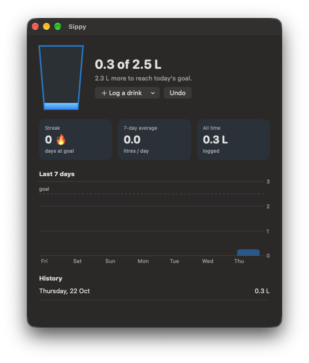
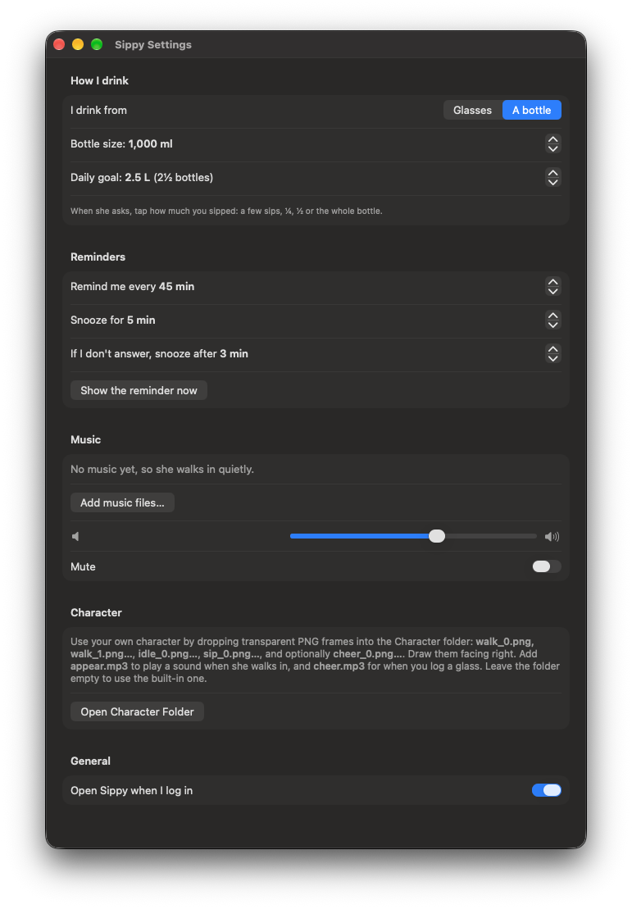
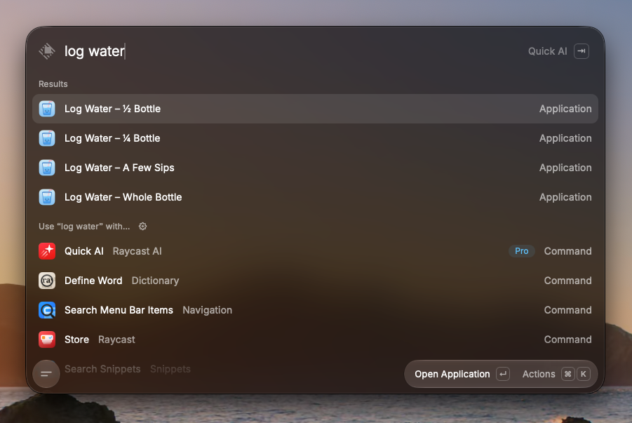

<p align="center">
  
</p>

<h1 align="center">Sippy</h1>

<p align="center">
  <b>A tiny character walks onto your Mac's screen, takes a sip, and reminds you to drink water.</b><br>
  Native macOS menu-bar app · lives in the background · works with glasses <i>or</i> a bottle · your own character, your own sounds.
</p>

<p align="center">
  
</p>

<p align="center">
  <a href="https://github.com/vipulchaudhary16/Sippy/releases/latest"><b>⬇️ Download</b></a>
  &nbsp;·&nbsp;
  <a href="docs/character-guide.md"><b>🎨 Make your own character with AI</b></a>
  &nbsp;·&nbsp;
  <a href="docs/architecture.md"><b>🛠 How it works</b></a>
</p>

> **Want the character to look like you, your partner, or your best friend?** The character above
> was made from a photo with an AI image generator. The **[Character guide](docs/character-guide.md)**
> walks you through it step by step: 10 copy-paste prompts, which image to attach for each one,
> how to check the frames, and where to put them. No design skills needed.

---

## Why

Water-reminder notifications are easy to swipe away and forget. Sippy reminds you with a little
desktop buddy instead: a character who walks out from the edge of your screen, drinks some water
in front of you, and asks if you did too. It's a lot harder to ignore someone who is visibly
hydrating at you.

## What a reminder looks like

<p align="center">
  
</p>

1. **Walks in** from any corner you pick (bottom-left by default) of whichever screen your mouse is on, playing an optional sound.
2. **Takes a sip** from their water bottle.
3. **Asks you** in a speech bubble: *Yes, I drank!* or *Snooze*.
4. **Cheers** (with an optional "yay" sound) when you log a drink, shows today's progress, then walks off.

If you're away, the character snoozes on their own after a few minutes rather than waiting forever.

## Features

| | |
|---|---|
| 🚶 **Desktop character** | Walks in from any corner: bottom-left, bottom-right, top-left or top-right. Transparent, always-on-top, shows on every Space and over full-screen apps. Never steals keyboard focus from what you're typing in. |
| ⏰ **Smart scheduling** | Custom interval and snooze. Optional **reminder hours** (e.g. 11:00–19:00, overnight ranges too) so it stays quiet outside your working day. Pauses while your screen is locked or asleep, and gives you a minute after you come back. Pause any time from the menu bar. |
| 🥛 **Glasses or bottle** | Glass mode counts glasses toward a daily goal. **Bottle mode** tracks litres: answer with *a few sips*, *¼*, *½* or *whole bottle*. |
| 🚪 **Calendar knocks** | A few minutes before each meeting the character walks in, knocks on your screen (knock-knock sound), and says *“Design review” starts in 5 min*, with a **Join meeting** button for Zoom/Meet/Teams links. Works with Google, iCloud, Outlook and other calendars in macOS Calendar. |
| 🔎 **Log from Spotlight** | Drank at a random time? ⌘Space → type **log water** → Enter. The character pops up in the middle of the screen and cheers (with your "yay"), and the reminder countdown restarts. Also a `sippy://` link for Shortcuts, Raycast or Alfred. |
| 📊 **Dashboard** | A glass that fills through the day, streak 🔥, 7-day average, a 7-day chart against your goal, and 30-day history. |
| 🎨 **Your own character** | Drop in PNG frames (walk, idle, sip, cheer), e.g. a chibi of you or someone you love, made with AI. Full guide below. |
| 🔊 **Your own sounds** | `appear.mp3` when the character arrives, `cheer.mp3` when you log a drink, plus optional looping music. Volume + mute. |
| 🔒 **Private** | No account, no network. Everything stays in `~/Library/Application Support/Sippy`. |
| 🪶 **Light** | ~1 MB app, menu-bar only (no Dock icon), opens at login if you want. |

<p align="center">
  
  &nbsp;&nbsp;&nbsp;
  
</p>

<p align="center">
  
  &nbsp;
  
</p>
<p align="center"><sub>Dashboard and Settings (bottle mode, dark appearance)</sub></p>

## Install

**Requirements:** macOS 13 Ventura or later, on Apple silicon or Intel.

### Download

1. Grab **`Sippy-x.y.z.dmg`** from the [latest release](https://github.com/vipulchaudhary16/Sippy/releases/latest).
2. Open it and drag **Sippy** into **Applications**.
3. Open Sippy. It isn't notarized by Apple (that needs a paid developer account), so macOS
   blocks the first launch:
   - **macOS 15 Sequoia and later:** click *Done*, then **System Settings → Privacy & Security**,
     scroll down, and click **Open Anyway** next to Sippy.
   - **macOS 13–14:** right-click Sippy in Applications → **Open** → **Open**.
   - Or in Terminal: `xattr -dr com.apple.quarantine /Applications/Sippy.app`

   You only do this once.

On first launch the character comes out to say hi. Then look for the **glass icon in the menu bar**.

**Next:** make the character your own with the **[Character guide](docs/character-guide.md)**.

### Build it yourself (no Xcode needed)

Sippy builds with just the Xcode **Command Line Tools** (`xcode-select --install`).

```sh
git clone git@github.com:vipulchaudhary16/Sippy.git
cd Sippy/native
scripts/build.sh --install   # checks, builds, installs to /Applications, launches
```

Without `--install`, you get `native/dist/Sippy.app`, `Sippy.zip` and `Sippy.dmg`. A local build
targets your Mac's architecture; `UNIVERSAL=1 scripts/build.sh` builds for both (needs full Xcode).

## Using Sippy

**Menu bar (glass icon)**

- Today's progress and when the next reminder is due
- **Remind Me Now** (⌘R): call the character immediately
- **Log a Glass / Log ¼ Bottle** (⌘L): log without waiting for a reminder
- **Pause Reminders** (⌘P)
- **Dashboard…** (⌘D) and **Settings…** (⌘,)

**Spotlight:** press ⌘Space and type **log water**. You'll see *Log Water – Glass* (glass mode) or
*A Few Sips / ¼ / ½ / Whole Bottle* (bottle mode). Press Enter: it's logged, and the character pops up in the middle of the
screen to cheer. (Turn off in Settings → General.)

<p align="center">
  
  <br><sub>“log water” in Raycast. The same actions show up in Spotlight and Alfred.</sub>
</p>

**Calendar knocks:** Settings → **Calendar** → *Knock before my calendar events*, and allow Calendar
access when macOS asks. Sippy reads the calendars in the macOS Calendar app, so for **Google Calendar**
add your Google account in System Settings → Internet Accounts first. Choose how many minutes before,
and tick the calendars to watch. All-day and declined events are skipped, and a meeting takes
priority over a water reminder. *Test knock* shows you what it looks like.

**Links for automation:** `sippy://log?amount=glass`, `sips`, `quarter`, `half`, `bottle`, or a number of
millilitres like `sippy://log?amount=330`. Use them from the Shortcuts app, Raycast, Alfred,
Stream Deck, or Terminal (`open "sippy://log?amount=half"`).

**Settings**

| Section | What you can change |
|---|---|
| How I drink | Glasses (glass size, goal in glasses) or a bottle (bottle size, goal in litres) |
| Calendar | Knock before events, how many minutes before, and which calendars to watch (off by default) |
| Reminder hours | Only remind between set times, e.g. 11:00–19:00 (off by default) |
| Reminders | Interval, snooze length, auto-snooze after no answer, "show the reminder now" |
| Music | Add songs that loop while the character is on screen, volume, mute |
| Character | Which corner the character comes from (left/right, bottom/top), and the Character folder for your own frames and sounds |
| General | Open Sippy when you log in, "Log Water" actions in Spotlight |

## Make the character yours

Sippy ships with a cute built-in character drawn in code. To replace it, put transparent PNG
frames and optional sounds in the **Character folder** (Settings → *Open Character Folder*):

```
~/Library/Application Support/Sippy/Character/
├── idle_0.png   idle_1.png              standing, then a blink
├── walk_0.png … walk_3.png              walk cycle, facing right
├── sip_0.png    sip_1.png               drinking
├── cheer_0.png  cheer_1.png             celebrating
├── knock_0.png  knock_1.png             knocking before a calendar event
├── appear.mp3                           plays once when the character walks in
├── cheer.mp3                            plays when you log a drink
└── knock.mp3                            plays when knocking (a knock is built in)
```

Every file is optional: missing poses fall back to the idle frame, and an empty folder means the
built-in character. Changes are picked up at the next reminder; no restart needed.

**➡️ [Character guide: generate your own character with AI, prompt by prompt](docs/character-guide.md)**

Check your frames before using them:

```sh
swift native/scripts/check_frames.swift
```

## Documentation

| Doc | For |
|---|---|
| [Character guide](docs/character-guide.md) | Making custom character art with AI image tools: every prompt, what to attach, how to check it |
| [Changelog](CHANGELOG.md) | What changed in each version |
| [Architecture](docs/architecture.md) | How the app is built: components, data files, scheduler, build pipeline, checks |
| [Original design spec](docs/superpowers/specs/2026-07-04-sippy-water-reminder-design.md) | The first design (Flutter prototype, since replaced) |

## Project layout

```
native/                  ← the app (Swift / SwiftUI, Swift Package)
  Sources/Sippy/         app: menu bar, overlay, dashboard, settings, audio
  Sources/SippyCore/     logic: settings, intake log, stats, scheduler, units
  Sources/SippyChecks/   logic checks (swift run SippyChecks)
  scripts/               build.sh, make_icon.swift, check_frames.swift
docs/                    documentation and images
```

Sippy started as a cross-platform Flutter prototype. Flutter's macOS builds need full Xcode, so it
was rewritten natively in Swift, which builds with only the Command Line Tools and comes out at ~1 MB.
The prototype is in the git history (before the Swift rewrite) if you're curious.

## Development

```sh
cd native
swift run SippyChecks                                  # logic checks (13 checks)
swift build && .build/debug/Sippy                      # run a debug build
.build/debug/Sippy --render-previews /tmp/p --builtin  # render overlay stages to PNG
scripts/build.sh                                       # release .app + .zip + .dmg
```

### Releasing

1. Add a section for the new version to [CHANGELOG.md](CHANGELOG.md). It becomes the release notes.
2. Bump `VERSION` in `native/scripts/build.sh`, commit, and push a tag:

```sh
git tag v1.2.1 && git push origin v1.2.1
```

GitHub Actions builds a universal app and publishes the release with the changelog notes, install
steps, `.dmg`, `.zip` and checksums ([workflow](.github/workflows/release.yml)). The run fails if the
changelog has no entry for that version.

## License

[MIT](LICENSE) © Vipul Chaudhary
