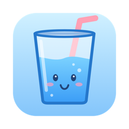
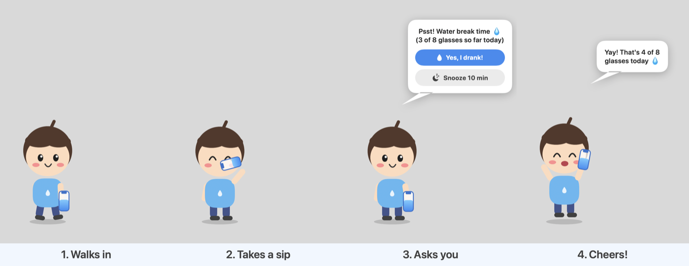
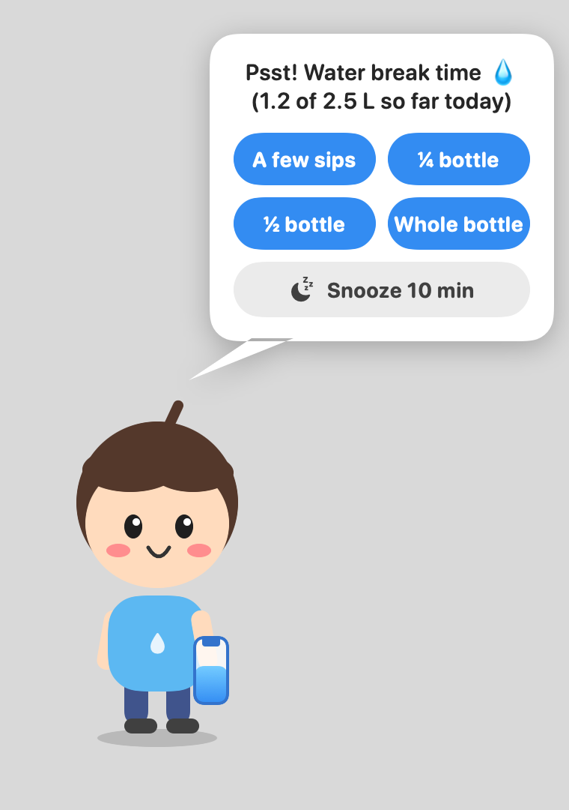
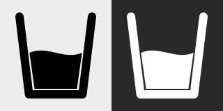

<p align="center">
  
</p>

<h1 align="center">Sippy</h1>

<p align="center">
  <b>A tiny character walks onto your Mac's screen, takes a sip, and reminds you to drink water.</b><br>
  Native macOS menu-bar app · lives in the background · works with glasses <i>or</i> a bottle · your own character, your own sounds.
</p>

<p align="center">
  
</p>

---

## Why

Water-reminder notifications are easy to swipe away and forget. Sippy reminds you with a little
desktop buddy instead: a character who walks out from the edge of your screen, drinks some water
in front of you, and asks if you did too. It's a lot harder to ignore someone who is visibly
hydrating at you.

## What a reminder looks like

<p align="center">
  
</p>

1. **Walks in** from the left edge of whichever screen your mouse is on, playing an optional sound.
2. **Takes a sip** from their water bottle.
3. **Asks you** in a speech bubble: *Yes, I drank!* or *Snooze*.
4. **Cheers** (with an optional "yay" sound) when you log a drink, shows today's progress, then walks off.

If you're away, the character snoozes on their own after a few minutes rather than waiting forever.

## Features

| | |
|---|---|
| 🚶 **Desktop character** | Transparent, always-on-top, shows on every Space and over full-screen apps. Never steals keyboard focus from what you're typing in. |
| ⏰ **Smart scheduling** | Custom interval and snooze. Pauses while your screen is locked or asleep, and gives you a minute after you come back. Pause any time from the menu bar. |
| 🥛 **Glasses or bottle** | Glass mode counts glasses toward a daily goal. **Bottle mode** tracks litres: answer with *a few sips*, *¼*, *½* or *whole bottle*. |
| 📊 **Dashboard** | A glass that fills through the day, streak 🔥, 7-day average, a 7-day chart against your goal, and 30-day history. |
| 🎨 **Your own character** | Drop in PNG frames (walk, idle, sip, cheer), e.g. a chibi of you or someone you love, made with AI. Full guide below. |
| 🔊 **Your own sounds** | `appear.mp3` when the character arrives, `cheer.mp3` when you log a drink, plus optional looping music. Volume + mute. |
| 🔒 **Private** | No account, no network. Everything stays in `~/Library/Application Support/Sippy`. |
| 🪶 **Light** | ~1 MB app, menu-bar only (no Dock icon), opens at login if you want. |

<p align="center">
  
  &nbsp;&nbsp;&nbsp;
  
</p>

## Install

**Requirements:** macOS 13 Ventura or later. Apple silicon or Intel (builds for the Mac you build on).

### Build it yourself (no Xcode needed)

Sippy builds with just the Xcode **Command Line Tools** (`xcode-select --install`).

```sh
git clone git@github.com:vipulchaudhary16/Sippy.git
cd Sippy/native
scripts/build.sh --install   # checks, builds, installs to /Applications, launches
```

Without `--install`, you get `native/dist/Sippy.app` and `native/dist/Sippy.dmg` to share.

### First launch

The app is ad-hoc signed, not notarized, so the first time macOS may say it "can't be opened".
**Right-click Sippy.app → Open → Open**. After that it opens normally.

On first launch the character comes out to say hi. Then look for the **glass icon in the menu bar**.

## Using Sippy

**Menu bar (glass icon)**

- Today's progress and when the next reminder is due
- **Remind Me Now** (⌘R): call the character immediately
- **Log a Glass / Log ¼ Bottle** (⌘L): log without waiting for a reminder
- **Pause Reminders** (⌘P)
- **Dashboard…** (⌘D) and **Settings…** (⌘,)

**Settings**

| Section | What you can change |
|---|---|
| How I drink | Glasses (glass size, goal in glasses) or a bottle (bottle size, goal in litres) |
| Reminders | Interval, snooze length, auto-snooze after no answer, "show the reminder now" |
| Music | Add songs that loop while the character is on screen, volume, mute |
| Character | Open the Character folder to add your own frames and sounds |
| General | Open Sippy when you log in |

## Make the character yours

Sippy ships with a cute built-in character drawn in code. To replace it, put transparent PNG
frames and optional sounds in the **Character folder** (Settings → *Open Character Folder*):

```
~/Library/Application Support/Sippy/Character/
├── idle_0.png   idle_1.png              standing, then a blink
├── walk_0.png … walk_3.png              walk cycle, facing right
├── sip_0.png    sip_1.png               drinking
├── cheer_0.png  cheer_1.png             celebrating
├── appear.mp3                           plays once when the character walks in
└── cheer.mp3                            plays when you log a drink
```

Every file is optional: missing poses fall back to the idle frame, and an empty folder means the
built-in character. Changes are picked up at the next reminder; no restart needed.

**➡️ [Character guide: generate your own character with AI, prompt by prompt](docs/character-guide.md)**

Check your frames before using them:

```sh
swift native/scripts/check_frames.swift
```

## Documentation

| Doc | For |
|---|---|
| [Character guide](docs/character-guide.md) | Making custom character art with AI image tools: every prompt, what to attach, how to check it |
| [Architecture](docs/architecture.md) | How the app is built: components, data files, scheduler, build pipeline, checks |
| [Original design spec](docs/superpowers/specs/2026-07-04-sippy-water-reminder-design.md) | The first design (Flutter era) |

## Project layout

```
native/                  ← the app (Swift / SwiftUI, Swift Package)
  Sources/Sippy/         app: menu bar, overlay, dashboard, settings, audio
  Sources/SippyCore/     logic: settings, intake log, stats, scheduler, units
  Sources/SippyChecks/   logic checks (swift run SippyChecks)
  scripts/               build.sh, make_icon.swift, check_frames.swift
docs/                    documentation and images
lib/ macos/ test/ …      original Flutter prototype (kept for history; not built)
```

Sippy started as a cross-platform Flutter app. Flutter's macOS builds need full Xcode, so it was
rewritten natively in Swift, which builds with only the Command Line Tools and comes out at ~1 MB.

## Development

```sh
cd native
swift run SippyChecks                                  # logic checks (13 checks)
swift build && .build/debug/Sippy                      # run a debug build
.build/debug/Sippy --render-previews /tmp/p --builtin  # render overlay stages to PNG
scripts/build.sh                                       # release .app + .dmg
```
