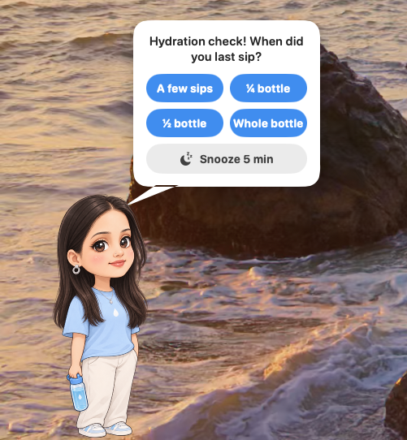

# Character guide: make your own Sippy character with AI

Sippy's character is just a set of transparent PNG frames. This guide shows you how to turn a
photo of yourself (or someone you love) into a full set of frames with an AI image generator,
one prompt at a time, and get them into the app.

<p align="center"></p>

The set takes about 10 generations and 20–30 minutes.

> **Ask first.** If you're making a character from someone else's photo, check they're happy
> to become a desktop character, especially before sharing screenshots.

---

## What you'll make

| File | Pose | Used when |
|---|---|---|
| `idle_0.png` | Standing, holding a bottle | The **master reference**. Standing while asking. |
| `idle_1.png` | Same, eyes closed | Blinks every few seconds |
| `walk_0.png` … `walk_3.png` | Walk cycle facing **right** | Walking in and out |
| `sip_0.png`, `sip_1.png` | Bottle at lips, then tipped up | Sipping |
| `cheer_0.png`, `cheer_1.png` | Arms up, then a little jump | After you log a drink |
| `knock_0.png`, `knock_1.png` | Fist raised, then knocking (no bottle) | Before a calendar event |

**Minimum viable character:** just `idle_0.png`. Every missing pose falls back to it, so you can
start with one image and add the rest whenever.

## Rules every frame must follow

These matter more than anything in the prompts. They're what make the animation smooth:

1. **Same canvas:** portrait **1024 × 1536** for every frame.
2. **Same size:** the character takes up the same height in every frame.
3. **Same ground line:** feet at the same height near the bottom edge. If one frame's feet are
   higher, the character visibly hops when switching to it (fine for `cheer_1`, nowhere else).
4. **Facing right** for all frames. Sippy mirrors them automatically when the character walks out,
   and when you set it to come in from the right (Settings → Character → Comes in from the Right).
5. **Transparent background:** no floor, no shadow, no text.

## Workflow

Use an AI image tool that can **edit from a reference image**. ChatGPT's image generation works
well and can output transparent PNGs.

1. Start a **new chat**. Upload **the photo** with Prompt 1. Regenerate until you love the result.
   This is your master reference; every other frame copies it.
2. Stay in the **same chat**. For each next prompt, attach the images listed in the table below.
3. Save each result and **rename it** to the file name shown.
4. Check it (see [Checking your frames](#checking-your-frames)), then drop it in the Character folder.

### What to attach

| # | Save as | Attach |
|---|---|---|
| 1 | `idle_0.png` | **The photo** (only this time) |
| 2 | `idle_1.png` | `idle_0.png` |
| 3 | `walk_0.png` | `idle_0.png` |
| 4 | `walk_1.png` | `idle_0.png` + `walk_0.png` |
| 5 | `walk_2.png` | `idle_0.png` + `walk_0.png` |
| 6 | `walk_3.png` | `idle_0.png` + `walk_1.png` |
| 7 | `sip_0.png` | `idle_0.png` |
| 8 | `sip_1.png` | `idle_0.png` + `sip_0.png` |
| 9 | `cheer_0.png` | `idle_0.png` |
| 10 | `cheer_1.png` | `idle_0.png` + `cheer_0.png` |
| 11 | `knock_0.png` | `idle_0.png` |
| 12 | `knock_1.png` | `idle_0.png` + `knock_0.png` |

**Why this way?**
- `idle_0.png` goes in **every time**. It locks the face and outfit.
- The photo is used **once**. If you keep attaching it, the AI drifts back toward the photo
  instead of the cartoon.
- The second attachment is **the previous frame of the same action**, so poses match each other
  in size and position.

---

## The prompts

Copy each block as-is. Edit the outfit or style in Prompt 1 if you like; later prompts say
"same outfit", so they follow whatever Prompt 1 produced.

### 1 → `idle_0.png` (the master reference)

*Attach: the photo.*

```
Turn the person in this photo into a cute chibi cartoon character for a desktop
water-reminder app. Keep them recognizable: same hairstyle, hair color, face
shape, eye shape, skin tone, and overall vibe.

Style: kawaii chibi, big head (about 1/3 of body height), big sparkly eyes,
soft pink blush on cheeks, small happy smile, clean smooth outlines, soft flat
shading, bright pastel colors, sticker-like.

Outfit: comfy casual: a light blue t-shirt with a small white water-drop logo,
and simple pants or a skirt with sneakers.

They hold a cute clear water bottle with blue water and a blue cap in their right
hand, down at their side.

Pose: standing relaxed, full body head to toe, side three-quarter view FACING
RIGHT. Feet resting on the bottom edge area of the image.

Technical: transparent background, portrait 1024x1536, character centered and
filling about 85% of the height, no ground shadow, no text, no border.
```

### 2 → `idle_1.png` (blink)

*Attach: `idle_0.png`.*

```
Same character, same outfit, same size, same position, same canvas, exactly the
same pose as the reference image. Only change: their eyes are closed in a happy
blink (curved ^ ^ shape). Transparent background, 1024x1536, facing right,
no shadow, no text.
```

### 3 → `walk_0.png` (stride)

*Attach: `idle_0.png`.*

```
Same character, same outfit, same size, same canvas, as the reference image.
They are walking to the RIGHT in a cheerful bouncy walk, side three-quarter view,
holding the water bottle in their swinging hand.

Frame pose: right leg stepping forward, left leg back, left arm forward, right
arm (with bottle) back.

Turn their body sideways facing right. Their feet must sit at the same height
near the bottom of the image as in the reference, and their body must be the
same size. Transparent background, 1024x1536, no shadow, no text.
```

### 4 → `walk_1.png` (passing step)

*Attach: `idle_0.png` + `walk_0.png`.*

```
Image 1 is the character reference. Image 2 is the previous animation frame —
match its size, position, and camera angle exactly, only change the pose.

Same character, same outfit, same size, same canvas. They are walking to the
RIGHT in a cheerful bouncy walk, side three-quarter view, holding the water
bottle in their right hand.

Frame pose: legs passing each other under their body (one leg straight
supporting their weight, the other knee slightly bent and lifting, feet close
together), body raised slightly higher than image 2, both arms close to their
sides, bottle hanging down near their hip.

Feet at the same height near the bottom of the image as image 2. Transparent
background, 1024x1536, no shadow, no text.
```

### 5 → `walk_2.png` (the other stride)

*Attach: `idle_0.png` + `walk_0.png`.*

```
Image 1 is the character reference. Image 2 is a previous animation frame —
match its size, position, and camera angle exactly, but MIRROR THE LIMBS.

Same character, same outfit, same size, same canvas, still facing and walking
to the RIGHT, side three-quarter view.

Frame pose: the opposite step of image 2. Their LEFT leg (the far leg, further
from the viewer) steps forward in front, their RIGHT leg (near leg) is behind.
Their RIGHT arm holding the water bottle swings FORWARD in front of their body,
and their LEFT arm swings back. Same stride width as image 2.

Do not just copy image 2: the bottle must be in front of their body this time.
Feet at the same height near the bottom of the image as image 2. Transparent
background, 1024x1536, no shadow, no text.
```

> AI tools often redraw `walk_0` here instead of mirroring it. With loose clothes it barely
> shows at 8 frames per second, so a near-copy is usable. Keep it if it lines up.

### 6 → `walk_3.png` (passing step, other foot)

*Attach: `idle_0.png` + `walk_1.png`.*

```
Image 1 is the character reference. Image 2 is the previous animation frame —
match its size, position, and camera angle exactly, only change the pose
slightly.

Same character, same outfit, same size, same canvas, facing and walking to the
RIGHT, side three-quarter view, holding the water bottle in their right hand.

Frame pose: a short in-between step, similar to image 2 but with the other foot
in front: feet closer together, body upright, arms near their sides, the bottle
hanging by their hip.

Feet at the same height near the bottom of the image as image 2. Transparent
background, 1024x1536, no shadow, no text.
```

### 7 → `sip_0.png` (bottle to lips)

*Attach: `idle_0.png`.*

```
Image 1 is the character reference. Same character, same outfit, same size,
same canvas, same standing position, and the same front three-quarter view as
image 1.

They are drinking water: they raise the water bottle to their lips, the bottle
tilted up at about 45 degrees with the spout touching their lips. Their eyes are
closed happily, cheeks blushing, other hand relaxed at their side or in a pocket.

Their feet must be in exactly the same spot and at the same height as image 1,
and their body the same size. Transparent background, 1024x1536, no shadow,
no text.
```

### 8 → `sip_1.png` (mid-gulp)

*Attach: `idle_0.png` + `sip_0.png`.*

```
Image 1 is the character reference. Image 2 is the previous animation frame —
match its size, position, and camera angle exactly, only change the pose
slightly.

Same character, same outfit, same canvas. They are mid-gulp: the water bottle
tipped HIGHER than in image 2 (bottom of the bottle pointing up at about 45
degrees), head tilted back a little, eyes still closed happily, cheeks slightly
puffed, and a couple of tiny water sparkles near the bottle.

Same hand holds the bottle as image 2, other hand unchanged. Feet in exactly the
same spot and height as image 2. Transparent background, 1024x1536, no shadow,
no text.
```

### 9 → `cheer_0.png` (celebrate)

*Attach: `idle_0.png`.*

```
Image 1 is the character reference. Same character, same outfit, same size,
same canvas, same front three-quarter view and standing position as image 1.

They are celebrating happily after drinking their water: big open happy smile,
eyes closed in joy (^ ^), both arms raised up in a V, the water bottle held up
high in one hand like a trophy. A few small sparkles and one little pink heart
floating near their head.

Feet flat on the ground, in exactly the same spot and height as image 1, body
the same size. Keep the arms and sparkles inside the canvas. Transparent
background, 1024x1536, no shadow, no text.
```

### 10 → `cheer_1.png` (little jump)

*Attach: `idle_0.png` + `cheer_0.png`.*

```
Image 1 is the character reference. Image 2 is the previous animation frame —
match its size, camera angle, and style exactly, only change the pose slightly.

Same character, same outfit, same canvas. They do a small happy jump: both
feet slightly off the ground (lifted about the height of their shoe), knees a
little bent, arms still up in a V with the water bottle held high, big open
smile, eyes closed in joy. The sparkles and heart are in slightly different
spots than image 2, as if they're twinkling.

Body the same size as image 2, horizontally in the same spot. Keep everything
inside the canvas. Transparent background, 1024x1536, no shadow, no text.
```

### 11 → `knock_0.png` (ready to knock)

*Attach: `idle_0.png`. A fresh chat works best, since a long chat full of bottle poses tends to
sneak the bottle back in.*

Knocking is about a meeting, not water, so these frames have **no bottle**. Hands are described
by **image side** (left/right of the picture), which AI tools follow more reliably than the
character's left/right.

```
Image 1 is the character reference. Same character, same face, hair, outfit,
size, canvas, standing position and camera angle as image 1.

IMPORTANT: in this pose there is NO water bottle anywhere. Remove the bottle
completely. Both hands are empty. Do not draw a bottle, cup, or any object.

Pose: the arm on the RIGHT side of the image is raised in front of the chest,
elbow bent, with an empty closed fist, knuckles facing the viewer, ready to
knock on the inside of the computer screen. The arm on the LEFT side of the
image hangs relaxed at their side with an empty open hand.

Expression: playful and cheeky, eyebrows raised, small open-mouth smile, eyes
looking at the viewer.

Feet in exactly the same spot and height as image 1. Transparent background,
1024x1536, no shadow, no text, no door drawn.
```

### 12 → `knock_1.png` (knock!)

*Attach: `idle_0.png` + `knock_0.png`.*

```
Image 1 is the character reference for the face and outfit only. Image 2 is
the previous animation frame: copy image 2 exactly and change ONLY the raised
fist.

There is NO water bottle anywhere, same as image 2. Both hands are empty.

The raised fist moves forward toward the viewer, mid-knock, knuckles hitting
the inside of the screen. Add two or three small curved impact lines around
the fist to show the knock. The other arm, the face, and everything else stay
identical to image 2.

Feet in exactly the same spot and height as image 2. Transparent background,
1024x1536, no shadow, no text, no door drawn.
```

> Sippy alternates the two frames quickly (6 per second) for a "knock-knock" while it plays the
> knock sound, then switches to the idle frame. Without knock frames, it uses `idle_0.png`.

---

## Checking your frames

Run the checker on your folder of frames (or with no argument, on Sippy's Character folder):

```sh
swift native/scripts/check_frames.swift ~/Downloads/my-character
```

```
Reference: idle_0.png (1024x1536, feet at y=1520)

✓ cheer_0.png  feet y=1504  body x 96-910  58% clear
✓ idle_1.png   feet y=1520  body x 194-780  58% clear
✓ walk_0.png   feet y=1516  body x 84-872  56% clear
⚠︎ walk_2.png  feet y=1440  body x 160-850  57% clear
    - feet 80px higher than reference, will jump
```

It flags wrong file names, mismatched canvas sizes, non-transparent backgrounds, halos from
semi-transparent pixels, and feet that don't line up (more than 12 px off; cheer frames may hop).

**"There's a dark glow around my character!"** Most image viewers draw transparent areas as
black or with a soft shadow. If the checker says the background is ~55–60% clear with only 1–2%
semi-transparent pixels, the image is fine; on the desktop you'll only see the character.

**No transparent background?** On macOS 14+: right-click the image in Finder →
*Quick Actions* → *Remove Background*.

## Install the frames

1. Sippy → **Settings… → Open Character Folder** (or `~/Library/Application Support/Sippy/Character`).
2. Copy your PNGs in with the exact names above.
3. Menu bar → **Remind Me Now** to see them. No restart needed.

## Add sounds (optional)

In the same folder:

| File | Plays | Tip |
|---|---|---|
| `appear.mp3` | Once, as the character walks in | Fades out when you answer. 3–10 s works well. |
| `cheer.mp3` | When you log a drink | Short: the cheer lasts ~2 s. A "yay!" is perfect. |
| `knock.mp3` | When knocking before a calendar event | A door knock, 1–2 s. Without one, Sippy plays a built-in knock. |

`.m4a`, `.wav`, `.aiff` and `.caf` work too. For longer background music that loops while the
character is on screen, use **Settings → Music** instead. Free sound effects:
[freesound.org](https://freesound.org), [pixabay.com/sound-effects](https://pixabay.com/sound-effects/).

## How Sippy plays the frames

| Pose | Frames | Speed | Fallback if missing |
|---|---|---|---|
| Walking | `walk_*` in order, looping | 8 fps | `idle_0` |
| Sipping | `sip_*` | 2 fps (slow gulps) | `idle_0` |
| Standing | `idle_0`, with `idle_1` flashed for ~0.2 s every 3.5 s | blink | first walk frame |
| Cheering | `cheer_*` | 3 fps | `idle_0` |
| Knocking | `knock_*` for ~2.4 s, then idle | 6 fps | `idle_0` |

Frames over 256 px wide are smoothed when scaled down; small frames (pixel art) stay crisp.
The character is drawn about 310 points tall.
